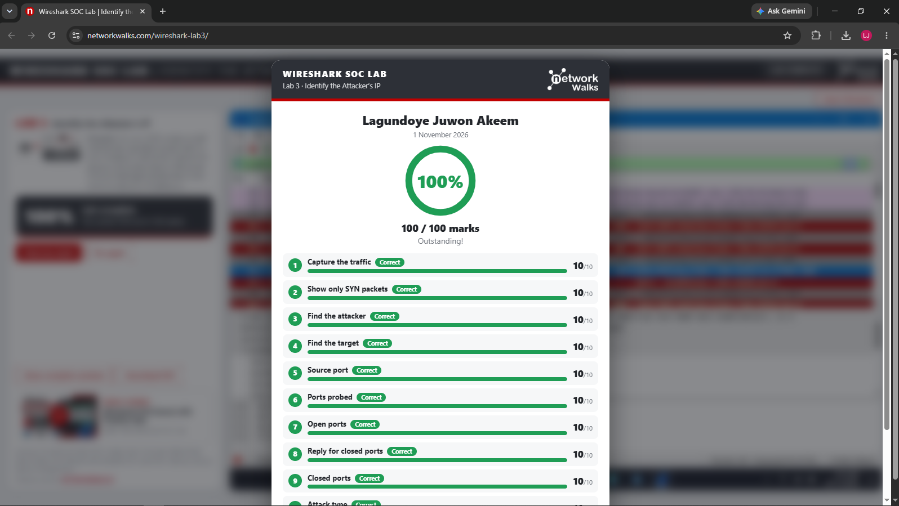
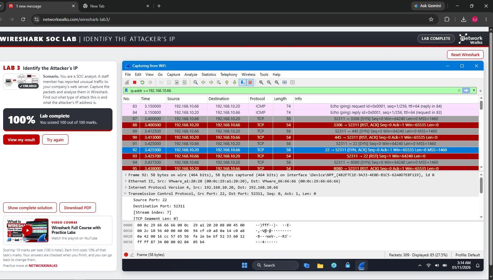
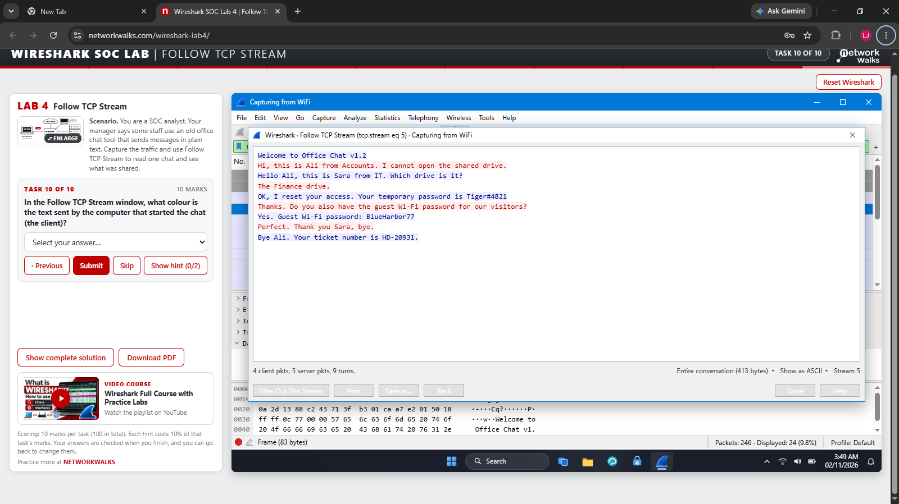
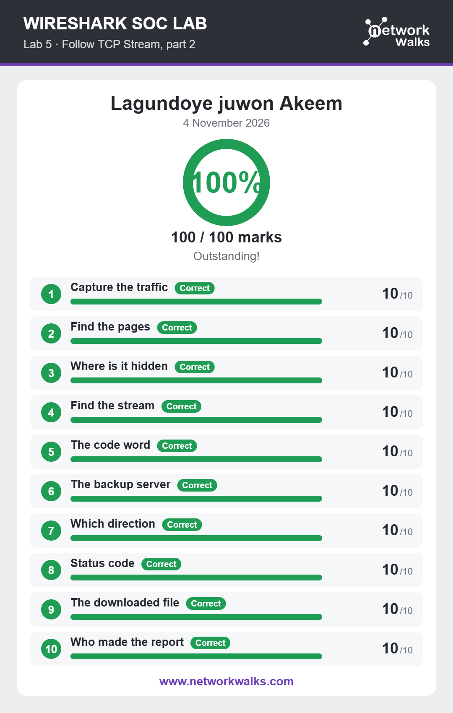
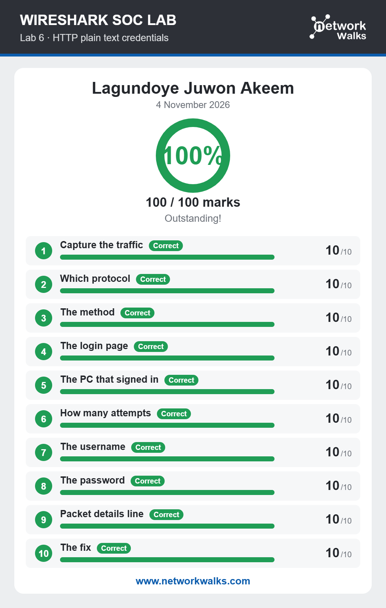
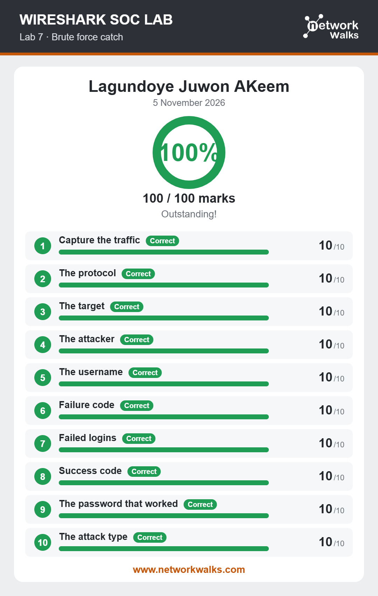
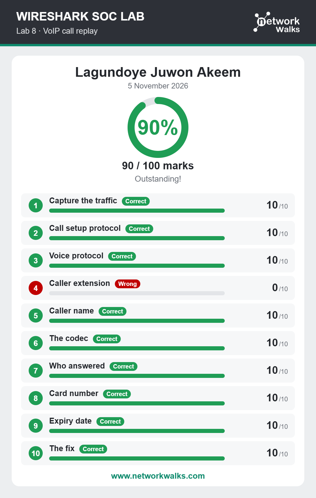

# NETWORKWALKS-B084G-WK1-PM1-CYBERSECURITY-LAB-SETUP-WIRESHARK
solved some networkwalks cybersecurity pratical labs using  wireshark  
# 🔐 Wireshark SOC Labs – Network Traffic Analysis

**Hands-on Network Traffic Analysis and Security Investigation using Wireshark**

---

## 📌 Project Overview

This project is part of the Week 1 Extra Project in the NetworkWalks Cybersecurity Internship 2026. 

The project focuses on practical network traffic analysis and security investigation using Wireshark through six hands-on SOC (Security Operations Center) laboratory exercises. 

Throughout these labs, I explored different cybersecurity scenarios, including identifying attackers' IP addresses, analyzing TCP communication, investigating exposed credentials, detecting brute-force attacks, and examining suspicious VoIP communication.

---

## 🎯 Objectives

* Understand network traffic analysis.
* Learn packet inspection using Wireshark.
* Identify suspicious IP addresses.
* Analyze TCP communication using Follow TCP Stream.
* Investigate HTTP plain-text credentials.
* Understand brute-force attacks.
* Analyze VoIP traffic and call replay.
* Practice Wireshark display filters.
* Develop practical SOC investigation skills.

---

## 🛡️ Purpose of the Project

This project aims to develop practical knowledge of network security monitoring and investigation. 

The skills practiced in these labs are relevant to:

* Network Traffic Monitoring
* Packet Analysis
* IP Address Investigation
* TCP Stream Analysis
* HTTP Security Analysis
* Credential Exposure Investigation
* Brute-Force Detection
* VoIP Traffic Analysis
* Basic SOC Operations

---

## 🏗️ Project Structure

| Lab | Project Title | Main Focus |
| :--- | :--- | :--- |
| Lab 3 | Identify the Attacker's IP | IP address investigation |
| Lab 4 | Follow TCP Stream | TCP communication analysis |
| Lab 5 | Follow TCP Stream - Part 2 | TCP stream investigation |
| Lab 6 | HTTP Plain Text Credentials | HTTP traffic analysis |
| Lab 7 | Brute Force Catch | Brute-force investigation |
| Lab 8 | VoIP Call Replay | VoIP traffic analysis |

---

## ⚙️ Tools & Environment

| Component | Configuration |
| :--- | :--- |
| Primary Tool | Wireshark |
| Lab Environment | NetworkWalks SOC Labs |
| Project Category | Network Security Analysis |
| Training Program | NetworkWalks Cybersecurity Internship 2026 |
| Week | Week 1 |
| Project Type | Extra Project |

---

## 🪜 Laboratory Exercises

### Step 1. Lab 3 – Identify the Attacker's IP

**Objective:** Identify the attacker's IP address by analyzing captured network traffic.

**What I Learned:**
* Inspecting source and destination IP addresses.
* Applying TCP SYN display filters.
* Identifying attacker and target IP addresses.
* Examining open and closed port responses.
* Recognizing network scanning activities.

**Lab Result:**

**Lab View:**

### Step 2. Lab 4 – Follow TCP Stream
Objective: Analyze TCP communication and investigate information exchanged between network endpoints.

**What I Learned:**

* Finding TCP communication ports.
* Identifying communication initiators.
* Understanding TCP stream numbers.
* Examining reconstructed conversations.
* Investigating transmitted information.
  
**Lab View:**
`

### Step 3.Lab 5 – Follow TCP Stream, Part 2
Objective: Investigate TCP communication and identify information hidden within network streams.

**What I Learned:**

* Finding specific pages in captured traffic.
* Locating hidden information in TCP streams.
* Identifying access code words.
* Finding backup server IP addresses.
* Investigating HTTP status codes and downloaded files.
**Lab Result:** 
`

###Step 4. Lab 6 – HTTP Plain Text Credentials
Objective: Investigate credentials transmitted through unencrypted HTTP communication.

**What I Learned:**

* Identifying HTTP traffic.
* Inspecting HTTP requests and responses.
* Finding login pages and submitted credentials.
* Identifying exposed usernames and passwords.
* Understanding the importance of HTTPS.
**Lab Result:**
`

### Step 5. Lab 7  Brute Force Catch
Objective: Investigate network traffic associated with brute-force attacks.

**What I Learned:**

* Understanding brute-force attacks.
* Identifying attackers and targets.
* Investigating failed login attempts.
* Identifying authentication failure codes.
* Finding successful authentication responses.
* Recognizing suspicious login patterns.
  **Lab Result:**
  `
  
### Step 6. Lab 8 – VoIP Call Replay

**Objective:** Investigate VoIP communication and understand security risks associated with exposed voice calls.

**What I Learned:**
* Identifying call setup protocols.
* Understanding voice communication protocols.
* Identifying caller extensions and names.
* Understanding audio codecs.
* Investigating recorded call information.
* Understanding SRTP encryption for secure VoIP communication.

**Lab Result:**
  `

---

## 🔎 Wireshark Display Filters

| Display Filter | Purpose |
| :--- | :--- |
| `tcp.flags.syn == 1` | Display TCP SYN packets
| `tcp.flags.ack == 1` | Display TCP ACK packets. |
| `tcp` | Display TCP traffic. |
| `http` | Display HTTP traffic. |
| `http.request.method == "POST"` | Display HTTP POST requests. |
| `ip.addr == 192.168.1.1` | Filter traffic involving a specific IP. |
| `udp` | Display UDP traffic. |
| `sip` | Display SIP packets. |
| `rtp` | Display RTP packets. |

---

## 💡 What I Learned

Through these six Wireshark SOC Labs, I gained practical experience in:

* Network traffic and packet analysis.
* Identifying suspicious IP addresses.
* TCP stream investigation.
* HTTP credential exposure analyse.
* Brute-force attack detection.
* VoIP traffic analysis and security.
* Basic SOC investigation techniques.

---

## ✅ Completion Summary

* **Total Labs:** 6
* **Completed Labs:** 6
* **Total Tasks:** 6
* **Completion Rate:** 100%
* **Total Score:** 600/600
* **Project Status:** Completed

---

## 🔗 Tools & Resources

* **Wireshark:** https://www.wireshark.org/
* **NetworkWalks:** https://networkwalks.com/

---

## 👤 Author

**Lagundoye Juwon Akeem**
*Aspiring Offensive Security Analyst*
